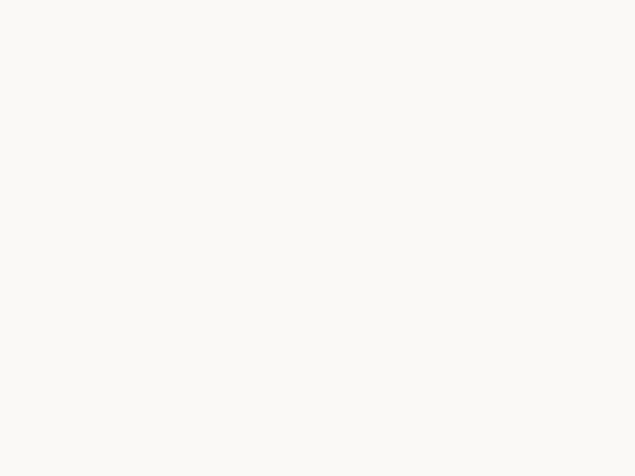
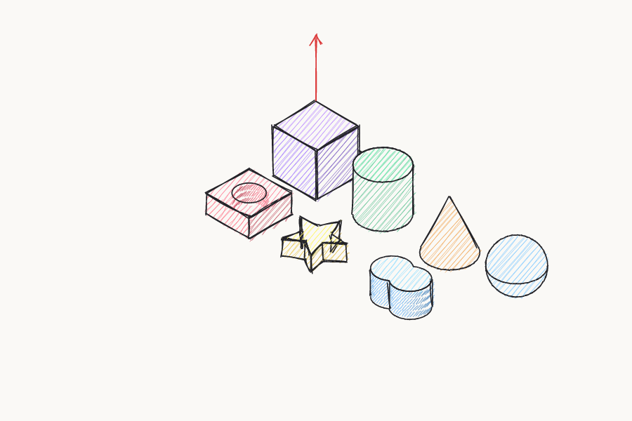
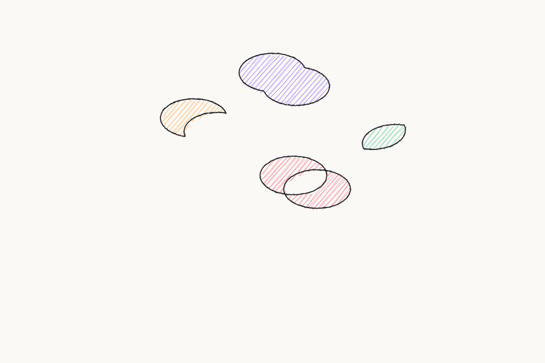
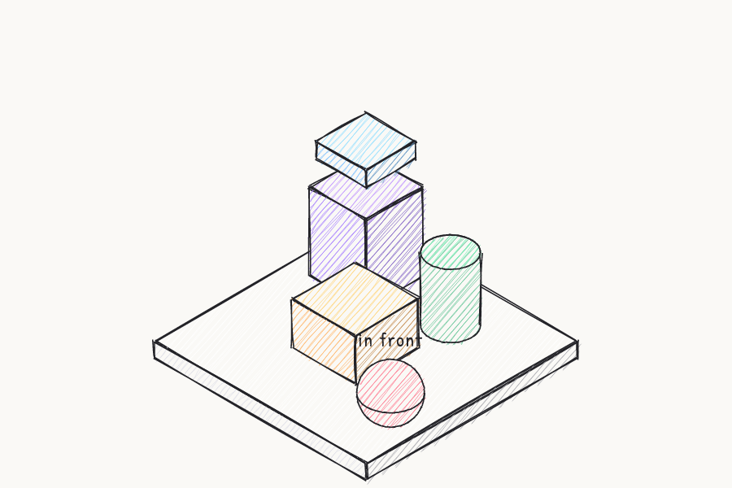
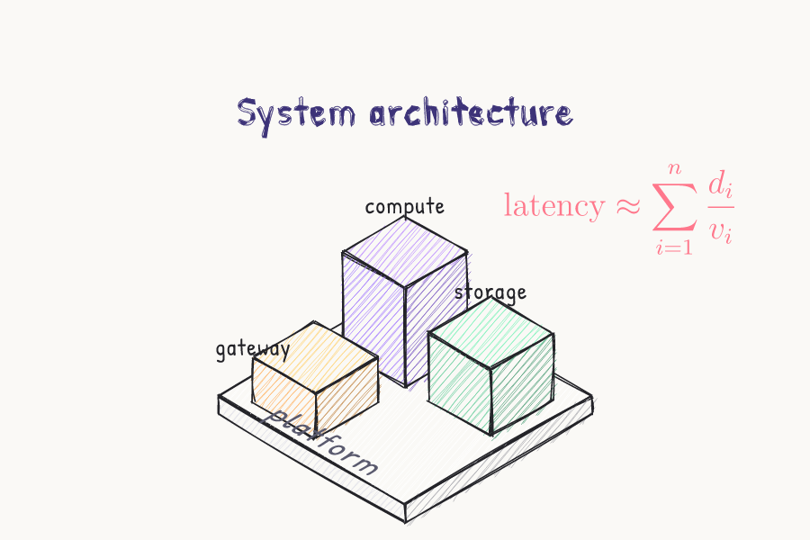
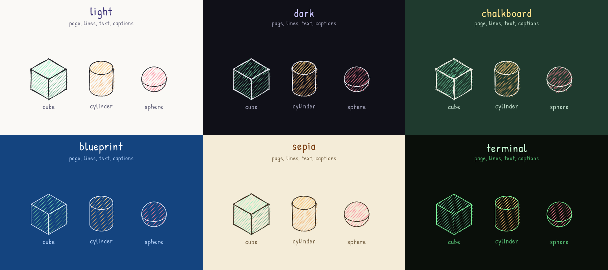
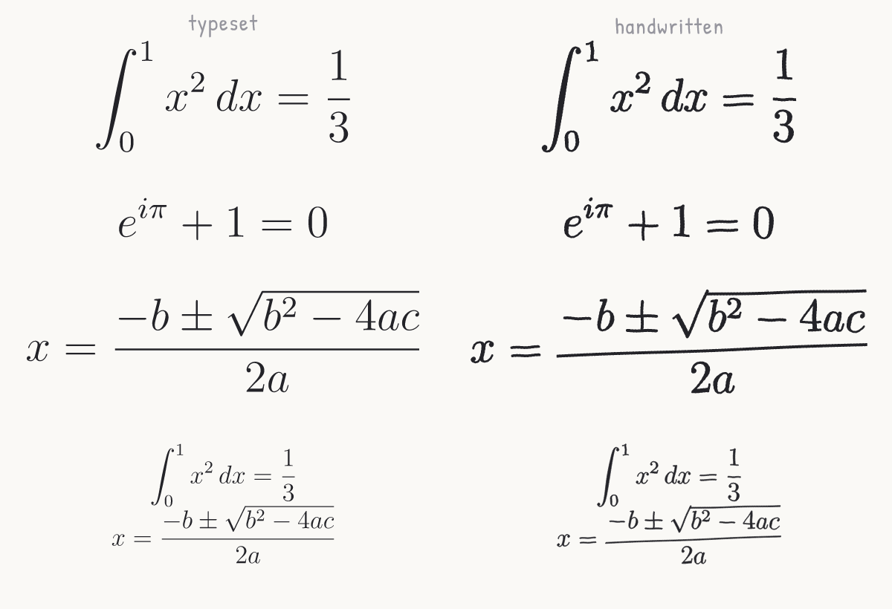

# Rough-Animations

**Hand-drawn 3D and 2D animations in Rust, in the spirit of [manim](https://www.manim.community/).**
Write a short script, get an mp4, gif or png that looks like it was sketched on a whiteboard.



📖 **[Documentation site](https://super-yojan.github.io/Rough-Animations/)**

▶ **[Watch the one-minute intro](docs/media/intro.mp4)**, which was made with the library itself
(`cargo run --release --example intro`).

## What it does

- **A whiteboard look.** Every line wobbles like a pen and fills are hatched, courtesy of
  [rough.js](https://roughjs.com/)-style drawing. Strokes can sit still or "boil" like a hand-drawn cartoon.
- **Isometric solids.** Cuboids, cylinders, cones, spheres and extruded prisms. Nearer objects hide the ones
  behind them, so stacking and overlap just work.
- **Flat shapes and boolean operations.** Circles, rectangles, stars and polygons, combined with
  `union`, `intersect`, `minus` and `xor`. Extrude the result into a solid with holes.
- **Morphing.** Turn any flat shape (or extruded solid) into any other.
- **Text and LaTeX.** A handwriting font, plus formulas typeset by LaTeX, written on letter by letter. Text is
  crisp and steady by default so it stays readable. Add `.handwritten()` to make a formula (or any text) look
  written by hand, or `.animate()` for a lively hand-inked look on a big title.
- **Animation building blocks.** `create`, `write`, `fade_in`, `move_to`, `rotate_by`, `fill_to`, `morph` and
  more, with easing, combined using `all`, `seq` and `lag`.
- **A small API.** Positions are tuples, colours are names, numbers can be ints or floats. A whole scene is a
  handful of lines, so it is easy to write by hand or to generate with an AI agent.

## Quick start

```toml
# Cargo.toml
[dependencies]
rough-animations = { git = "https://github.com/Super-Yojan/rough-animations" }
```

```rust,no_run
use rough_animations::prelude::*;

fn main() -> Result {
    let mut s = Stage::new(900, 600);                                   // hand-drawn look, isometric camera
    let tower = s.add(cuboid(80, 110, 80).base_at((0, 0, 0)).fill("purple"));
    let note = s.add(text("compute").at((0, 150, 0)));
    s.play(create(tower));                                              // outline traced, then filled in
    s.play(write(note));
    s.play(all([move_by(tower, (100, 0, 0)), fill_to(tower, "rose")]).duration(1.5));
    s.wait(0.5);
    s.render("out.mp4")                                                 // .mp4 .webm .gif, or .png for the last frame
}
```

**Requirements**

| For | You need |
|---|---|
| Building | Rust 1.85 or newer (the crate uses edition 2024) |
| `.mp4`, `.webm`, `.gif` output | [`ffmpeg`](https://ffmpeg.org/) on your `PATH` |
| `math(..)` and `latex(..)` | `pdflatex`, plus `pdftocairo` (poppler) or `mutool` (MuPDF) |

PNG output and everything else work without any of these.

## Gallery

| | |
|---|---|
|  |  |
| Solids, extruded shapes and arrows ([`shapes.rs`](examples/shapes.rs)) | `union`, `intersect`, `minus`, `xor` ([`shapes.rs`](examples/shapes.rs)) |
|  |  |
| Stacking and hidden lines ([`occlusion.rs`](examples/occlusion.rs)) | Labels, floor text and LaTeX ([`text.rs`](examples/text.rs)) |

## A tour

### Shapes and booleans

Every shape is one short function that returns an `Object`. Chain builders on it: `.at(..)` places the
centre, `.base_at(..)` stands a solid on a point, `.fill("mint")` colours it.

```rust,no_run
use rough_animations::prelude::*;

fn main() -> Result {
    let mut s = Stage::new(900, 600);
    s.add(cube(70).base_at((-150, 0, 0)).fill("purple"));
    s.add(sphere(36).base_at((-40, 0, 0)).fill("sky"));
    // Combine flat shapes, then extrude the result into a solid with a hole.
    let plate = rect(80, 80).minus(circle(25));
    s.add(prism(plate, 30).base_at((90, 0, 0)).fill("rose"));
    s.render("shapes.png")
}
```

### Animation

Animations are values: build them, tweak them, combine them, `play` them.

```rust,no_run
use rough_animations::prelude::*;

fn main() -> Result {
    let mut s = Stage::new(900, 600);
    let a = s.add(circle(50).fill("purple"));
    let b = s.add(cuboid(60, 60, 60).base_at((120, 0, 0)).fill("mint"));
    s.play(all([create(a), create(b)]).duration(1.2));
    s.play(morph(a, star(5, 70, 30)).ease(Easing::BackOut));       // circle into a star
    s.play(lag(0.3, [move_by(a, (0, 0, 80)), move_by(b, (0, 0, 80))]));
    s.play(rotate_by(b, (0, deg(90), 0)).duration(1).delay(0.5));  // duration first, then delay
    s.render("anim.mp4")
}
```

`create`, `write` and `fade_in` hide their object until they start, so you never hide it yourself.

### Groups

A thing made of several parts (a rover, a character) is a `Group`. Add the parts, then move, turn and fade it as
one:

```rust,no_run
use rough_animations::prelude::*;

fn main() -> Result {
    let mut s = Stage::new(900, 600);
    let mut rover = Group::new();
    s.add_to(&mut rover, cuboid(120, 30, 70).base_at((0, 10, 0)).fill("white"));
    s.add_to(&mut rover, cylinder(14, 10).at((40, 14, 40)).rotated((deg(90), 0, 0)).fill("ink"));
    s.add_to(&mut rover, cylinder(14, 10).at((-40, 14, 40)).rotated((deg(90), 0, 0)).fill("ink"));

    s.play(rover.create());                              // the parts build up one after another
    s.play(rover.move_by((80, 0, 0)).duration(2));       // the whole rover drives
    s.play(rover.rotate_by((0, deg(90), 0)));            // and turns on the spot, wheels included
    s.render("rover.mp4")
}
```

`move_to`, `scale_by`, `fade_in`, `fade_out` and the rest work the same way, and each part is still an ordinary
object you can animate on its own ([`rover.rs`](examples/rover.rs) is a fuller example).

### Themes

One call changes the page and the default colours of lines, text, titles and captions together. There are six
built in (`light`, `dark`, `chalkboard`, `blueprint`, `sepia`, `terminal`), and the same script looks right in
all of them:



```rust,no_run
use rough_animations::prelude::*;

fn main() -> Result {
    let mut s = Stage::new(900, 600).theme("chalkboard");
    s.heading("Chalkboard", "the same script works in any theme");
    s.add(cube(80).base_at((0, 0, 0)).fill("mint"));
    s.render("chalk.png")
}
```

Colours you choose yourself are never touched. Make your own with `Theme::custom("#06283d", "#e0f2ff")`, adding
`.title(..)`, `.caption(..)` and `.sketch(..)` as you like ([`themes.rs`](examples/themes.rs) renders the picture above).

### Text, LaTeX and layout

Text is upright on screen by default and can also lie in a plane of the scene. It is drawn crisp and steady so
it stays readable; `.animate()` (used on the title below) switches on the wobbling hand-drawn look, which suits
big titles. `.tracking(0.1)` adjusts letter spacing. `s.pixel(x, y)` turns a screen
pixel into a world position, which is the easy way to place titles; `zoom` scales the whole scene.

```rust,no_run
use rough_animations::prelude::*;

fn main() -> Result {
    let mut s = Stage::new(1280, 720).zoom(1.4);
    let title = s.add(text("Hello").font_size(90).color("#3c3278").animate().at(s.pixel(640, 120)));
    let formula = s.add(math(r"\int_0^1 x^2\,dx = \frac{1}{3}")?.font_size(70).color("rose").handwritten().at(s.pixel(640, 320)));
    s.play(write(title));
    s.play(write(formula).duration(2));
    s.render("hello.mp4")
}
```

### The look

`Stage::new(..).sketch(Sketch::clean())` gives straight lines and `.wobble(8)` redraws the strokes eight times a
second for a "boiling line" cartoon feel. `.theme("dark")` changes the page and the default colours together;
`.background(..)` on its own changes only the page, so on a dark page use a theme or the dark ink will vanish.



`.handwritten()` bends every outline gently, turns and sizes each letter a little differently, lets the line
drift and adds a pen's weight. It is calculated once, so it does not flicker, and the result stays readable even
at small sizes ([`handwritten.rs`](examples/handwritten.rs)).

The full API fits on one page: **[`docs/cheatsheet.md`](docs/cheatsheet.md)**. It is also the front page of
`cargo doc --open`, and a test checks every claim in it against the real code.

## Examples

Run any of them with `cargo run --release --example <name>`:

| Example | Produces |
|---|---|
| `hello` | `target/hello.mp4`, the smallest useful script |
| `architecture` | `architecture.png`, a still isometric sketch |
| `animate` | `target/animate.mp4` and `.gif`, the scene being built up |
| `shapes` | `target/shapes.png` and `target/booleans.png` |
| `morph` | `target/morph.mp4`, shapes and solids morphing |
| `text` | `target/text.mp4` and `.png`, labels and a formula |
| `avatar` | `target/avatar.mp4` and `.png`, a blocky 3D avatar that draws itself, blinks and smiles |
| `rover` | `target/rover.mp4` and `.png`, a rover built as a `Group` that drives and turns |
| `themes` | `target/themes.png`, the same scene in all six built-in themes |
| `handwritten` | `target/handwritten.png`, typeset and handwritten formulas side by side |
| `occlusion` | `target/occlusion.png`, stacking and overlap |
| `intro` | `docs/media/intro.mp4`, the intro video |

## Using it with AI agents

The library is designed to be easy for an agent to drive, and the repo includes a
[skill](skills/rough-animations/SKILL.md) that teaches the workflow: write a short script, draw a still
first, then check the motion from sampled frames (an agent can't watch a video). It also bundles the whole API
(the cheat sheet) and a table of what each error means, plus two helper scripts, `contact-sheet.sh` (tiles
frames from across a video into one image) and `frame.sh` (saves a single frame).

### Install the skill

**Claude Code**, as a plugin:

```text
/plugin install rough-animations --marketplace Super-Yojan/rough-animations
```

or in two steps, on older versions:

```text
/plugin marketplace add Super-Yojan/rough-animations
/plugin install rough-animations@rough-animations
```

**Any agent**, with one line. It downloads the skill and puts it in `~/.claude/skills`:

```sh
curl -fsSL https://raw.githubusercontent.com/Super-Yojan/rough-animations/main/scripts/install-skill.sh | bash
```

| Add this after `bash -s --` | To |
|---|---|
| `--project` | install for the current project only (`./.claude/skills`) |
| `--dir PATH` | install into `PATH/rough-animations`, for any agent that reads `SKILL.md` folders (give the folder that agent loads skills from) |
| `--ref NAME` | install a particular branch or tag |
| `--uninstall` | remove it again |

For example: `curl -fsSL .../install-skill.sh | bash -s -- --dir ~/my-agent/skills`. Running it again updates the
skill in place. It needs `bash`, `curl` and `tar` (on Windows, use WSL or Git Bash).

**By hand**: copy the [`skills/rough-animations`](skills/rough-animations) folder into your agent's skills folder.

Agents working inside a clone of this repo get the skill automatically (`.claude/skills/rough-animations` links
to the same folder). After editing `docs/cheatsheet.md`, run `scripts/sync-skill.sh` to refresh the skill's copy;
`cargo test` fails if you forget.

## How it works

- **Drawing.** Shapes become polygons, and [`roughr`](https://crates.io/crates/roughr) (a port of rough.js)
  turns them into wobbly strokes and hatched fills, rasterised by [`tiny-skia`](https://crates.io/crates/tiny-skia).
  Strokes are seeded per object, so they stay put from frame to frame instead of shimmering.
- **Ordering.** The camera is isometric, so one object is in front of another if it lies entirely on the
  near side of it along x, y or z. Objects are ordered with that rule on their 3D bounding boxes, and filled
  shapes first paint an opaque patch of paper colour so nearer shapes hide the lines behind them.
- **Booleans and morphing** work on 2D regions ([`i_overlay`](https://crates.io/crates/i_overlay)). A morph
  pairs up outlines, gives each pair the same number of points and interpolates them.
- **Text.** Plain text comes from font outlines. LaTeX is compiled by `pdflatex` and converted to SVG, and its
  glyph outlines are used just like font ones. By default they are filled exactly and revealed with a wipe, so
  nothing flickers. `.handwritten()` bends the outlines with a small deterministic wobble, per-letter
  turn and size, and a pen weight; `.animate()` runs them through the rough drawing pipeline instead.
- **Video.** Frames are piped as raw RGBA to `ffmpeg`.

## Limitations

- The camera is isometric only. There is no perspective camera and no camera animation, only a fixed zoom
  and origin.
- Booleans work on flat shapes. Extrude a combined shape to get a solid with holes; there are no 3D booleans.
- Ordering is exact for boxes and approximate for the rest. A concave extruded shape can order its own walls
  imperfectly, and solids that pass through each other are sorted by their centres.
- Upright text labels are always drawn on top, even if the thing they label is partly hidden.
- A `Stage` plays once, so build a fresh one for each video.
- LaTeX goes through `pdflatex` and a PDF to SVG converter. There is no `dvisvgm` route yet.
- Text uses plain glyph advances, with no kerning.

## Project layout

```text
src/
  api/         Stage, shape constructors, colours, numbers, errors (the prelude comes from here)
  animation/   tweens, easing, morphing, combinators
  world/       objects, transforms, styles, the scene and its ordering
  primitives/  solids, flat shapes, lines, text
  planar/      2D regions, booleans, morphing
  text/        font layout and the LaTeX pipeline
  render/      camera, partial drawing, paper underlays, ffmpeg export
  prelude/     the one import a script needs
examples/      runnable scripts (see above)
tests/         checks that the cheat sheet matches the code
docs/          the cheat sheet and the media used in this README
skills/        the agent skill (SKILL.md and scripts to inspect rendered videos); .claude/skills links here
.claude-plugin/ the plugin and marketplace manifests that make it installable in Claude Code
scripts/       install-skill.sh (one-line installer) and sync-skill.sh (keeps the skill's API in step with the cheat sheet)
assets/        the bundled handwriting font
```

## Development

```sh
cargo test       # unit tests, cheat-sheet, skill and installer checks, and every code block in this README and the skill
cargo doc --open
```

## Credits

Inspired by [manim](https://www.manim.community/) and [rough.js](https://roughjs.com/). Built on
[`roughr`](https://crates.io/crates/roughr) and `rough_tiny_skia`, [`tiny-skia`](https://crates.io/crates/tiny-skia),
[`i_overlay`](https://crates.io/crates/i_overlay), [`ttf-parser`](https://crates.io/crates/ttf-parser) and
[`usvg`](https://crates.io/crates/usvg). The bundled font is
[Patrick Hand](https://fonts.google.com/specimen/Patrick+Hand) by Patrick Wagesreiter
(SIL Open Font License 1.1, see [`assets/fonts/OFL.txt`](assets/fonts/OFL.txt)).

## License

No license has been chosen for this project yet.
